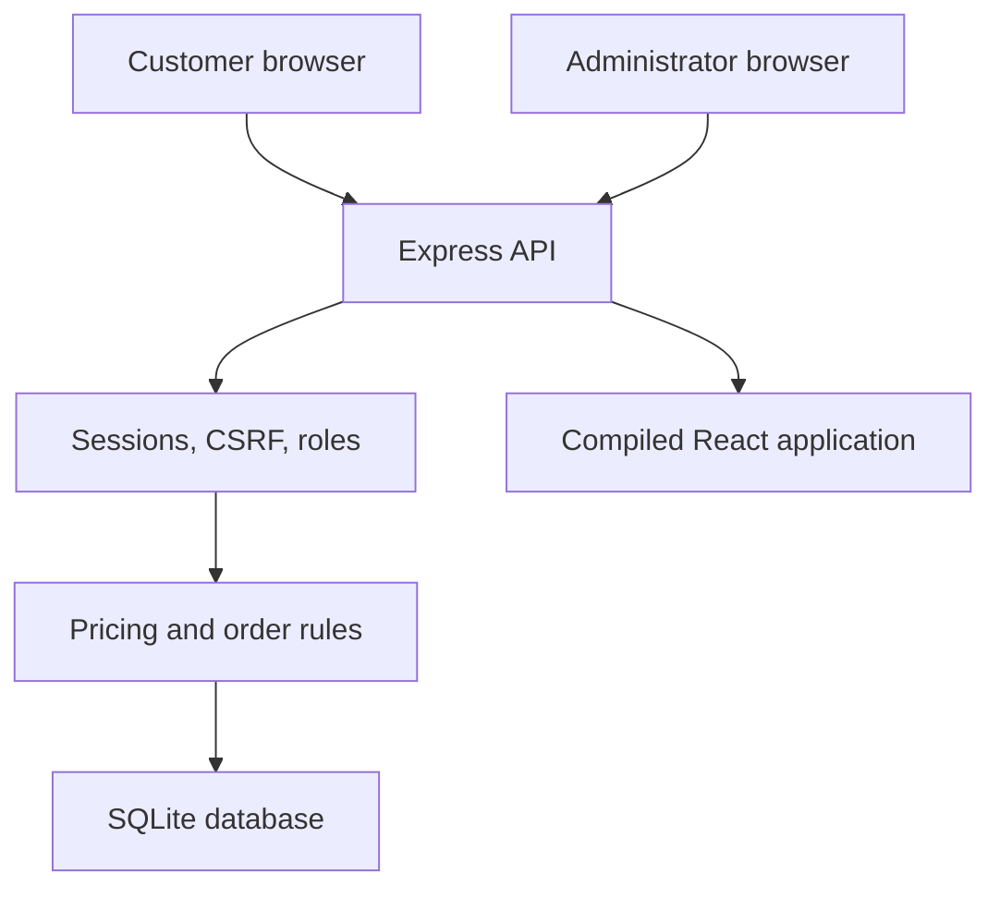
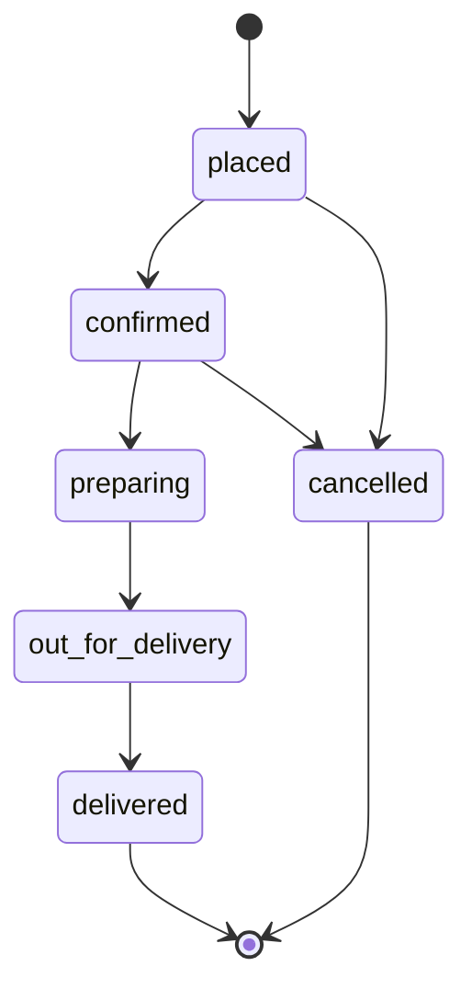

# Architecture

## Runtime

The browser runs a React/TypeScript single-page app. Hash-based routes support direct navigation without a frontend routing dependency. Vite creates `dist/`; Express serves those files and same-origin `/api` endpoints in a single process. In development, Vite proxies API requests to Express.

The backend runs on Node.js 24 and uses its built-in `node:sqlite` API. No native SQLite npm binding or database server is required. Password hashing uses asynchronous Node scrypt. Database work is short synchronous queries inside explicit transactions.

## Data model

| Table               | Responsibility and invariants                                                           |
| ------------------- | --------------------------------------------------------------------------------------- |
| `schema_migrations` | Records applied SQL filenames; each migration is atomic                                 |
| `users`             | Case-insensitive unique email; scrypt password; customer/admin role                     |
| `sessions`          | Hashed random session token, owning user, CSRF token, expiry                            |
| `auth_limits`       | Persistent rate-limit counters and reset times                                          |
| `restaurants`       | Catalog, delivery fee, minimum subtotal, ETA estimate, open status                      |
| `menu_items`        | Restaurant-owned dish, integer price, category, image, availability                     |
| `favorites`         | Unique user/restaurant pair                                                             |
| `addresses`         | User-owned delivery addresses; at most one default per user                             |
| `cart_items`        | Unique user/item; quantity 1–20                                                         |
| `coupons`           | Percentage, maximum discount, minimum subtotal, first-order condition                   |
| `orders`            | User/restaurant, money totals, immutable address snapshot, status, payment, idempotency |
| `order_items`       | Purchased dish name, unit price and quantity snapshots                                  |
| `order_events`      | Timestamped state history                                                               |
| `reviews`           | At most one verified review per delivered order                                         |
| `admin_audit`       | Actor, action, entity and timestamp for administration                                  |

WAL mode improves read/write coexistence; a 5-second SQLite busy timeout handles brief contention. Foreign keys are enabled on every connection. Application code uses parameter binding for all user-controlled SQL values. Search uses bound `LIKE` patterns.

## Session model

A 256-bit random session token lives in an HttpOnly, SameSite=Lax browser cookie. Only its SHA-256 hash is stored in SQLite. Sessions expire after seven days. The backend looks up the current database role on each request. A separate random CSRF value is returned by login and `/auth/me`; the client holds it in memory and sends `X-CSRF-Token` for authenticated mutations.

State-changing requests reject unapproved browser origins and `Sec-Fetch-Site: cross-site`. All protected mutations additionally require CSRF validation. Login/registration are protected by origin checks and rate limits. The server does not enable permissive CORS.

Passwords use scrypt with independent random salts. Password changes verify the old password and invalidate the user's other sessions. Passwords, full session cookies, and addresses are not included in application error logs. Log identifiers are random request UUIDs.

Guest baskets live in browser local storage. Signed-in baskets live in SQLite. Signing in with a non-empty current-device guest basket saves that basket to the account; otherwise, the saved account basket is restored. This behavior is explained on the sign-in screen.

## Pricing

All currency values are integer **paise**. The UI formats them as INR. Menu prices are sample tax-inclusive amounts.

1. Verify all items exist and are available.
2. Reject duplicate item IDs, fractional/out-of-range quantities, and multiple restaurants.
3. Verify the restaurant is open.
4. Compute subtotal using current database prices.
5. Validate an optional coupon and first-order eligibility.
6. Compute `discount = min(floor(subtotal * percent / 100), max_discount)`.
7. Waive the restaurant's delivery fee when the pre-discount food subtotal is at least ₹499.
8. Compute `total = subtotal - discount + delivery_fee`.
9. Require the restaurant minimum subtotal before committing an order.
10. Compare the user's accepted total against the freshly calculated total. Return 409 on mismatch.

No request field can set unit price, discount, delivery fee, role, or payment status. The accepted total is a consent check, not a trusted pricing input.

## Checkout transaction and retries

The client creates an `Idempotency-Key` UUID for each distinct checkout payload. The database enforces uniqueness on `(user_id, idempotency_key)`. A hash of the validated payload binds the key to the request.

Inside one `BEGIN IMMEDIATE` transaction, the server checks an existing key, validates the address, prices the order, writes the order, writes its line-item snapshots and first event, then clears the customer's saved cart. Any exception rolls the entire operation back. A repeated identical request returns the original order; changing the payload while reusing its key returns 409.

Because the replay check runs before rechecking first-order coupons, retrying a successful FIRSTBITE purchase returns its order even though the customer now has an order.

## Fulfillment state machine

Customers may cancel their own placed/confirmed orders. Administrators can record only the next valid state or an early cancellation. Delivery confirmation also records COD payment as collected. Terminal states cannot move backward. Every status transition is persisted with the actor and timestamp.

The order detail view polls every 8 seconds, customer history every 10 seconds, and admin overview every 15 seconds. Polling shows actual recorded server events; it is not a real courier integration. A delivered order can receive one review from its owner. Restaurant ratings are computed from these reviews; new kitchens display “New” instead of invented ratings.

## UI behavior and accessibility

- Desktop sidebar basket; mobile basket dialog and bottom navigation.
- Search debouncing and request cancellation prevent stale search results.
- Explicit confirmations for changing kitchen, cancelling an order, and recording delivery/payment.
- Dialog keyboard focus trapping, Escape handling, focus restoration, and scroll locking.
- Accessible control labels, status/error announcements, visible focus states and reduced-motion support.
- Loading, empty, error and retry states for major remote views.
- Bundled SVG artwork and system fonts; no runtime CDN dependency.

## Capacity and extension boundary

This is a single-instance SQLite architecture intended for local use, demonstrations, and a measured small deployment. It has no established traffic-capacity claim. Synchronous SQLite work and one database writer are intentional simplicity tradeoffs. Move to a server database and shared rate limiting/job infrastructure before horizontally scaling.

The seeded catalog and flat delivery rules can be replaced. Real payment, dispatch, SMS, email, maps, service-area validation, refunds, accounting, taxes, merchant onboarding, moderation, scheduling, monitoring, and multi-tenant permissions require dedicated integrations and business rules before a public commercial rollout.
